  
  
  
  
  
  

  The order book above is live: Coinbase level-2 data → Python, standard library only → one animated SVG,
  re-rendered every 20 minutes by <a href="https://github.com/grzresearch/grzresearch/blob/main/.github/workflows/liquidity-field.yml">GitHub Actions</a>.
  Every particle is resting liquidity at its price level.

